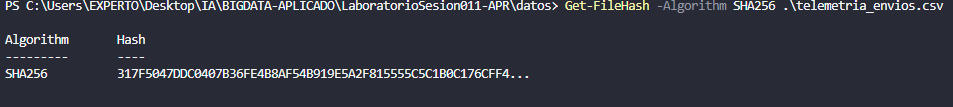
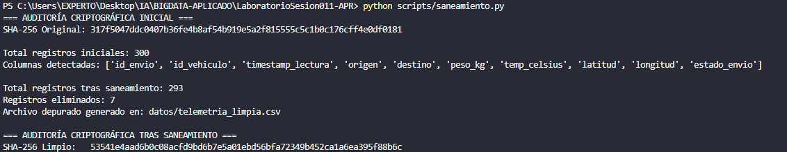
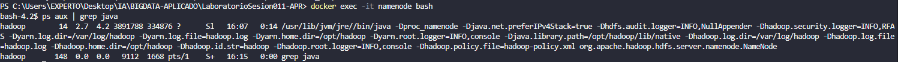
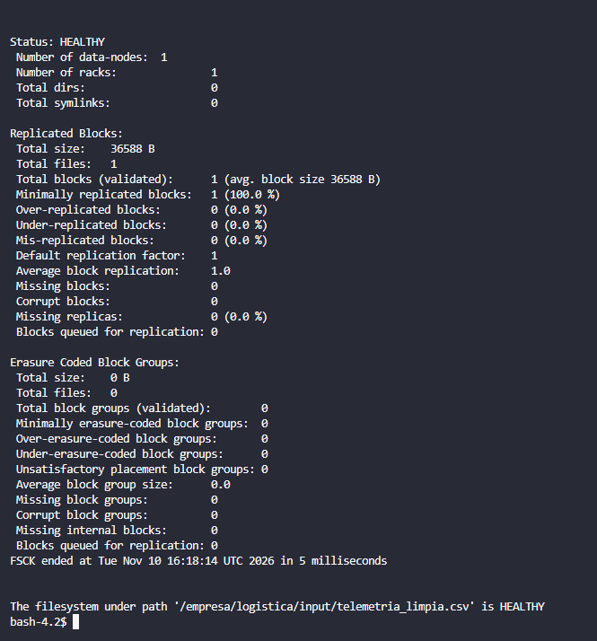
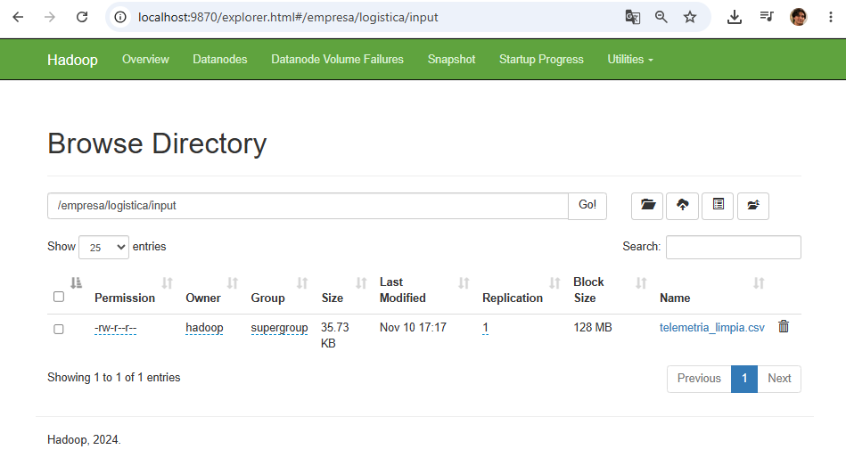

# Práctica UD01 Sesión 11: Integridad del Dato y Almacenamiento en HDFS

**Módulos:** 5074 (Sistemas de Almacenamiento del Big Data) & 5075 (Calidad del Dato)  
**Autor:** Ángel Postigo Cámara  
**Entorno:** Apache Hadoop 3.4.0 (Docker), Python 3.13, HDFS  

---

## 1. Introducción y Arquitectura

En entornos de ingeniería de datos y distribución logística, la ingesta masiva de telemetría requiere dos pilares indispensables antes de cualquier fase analítica (*KDD*):
1. **Auditoría e Integridad en Origen:** Certificación criptográfica y saneamiento de anomalías físicas y lógicas.
2. **Almacenamiento Distribuido Resiliente:** Persistencia en un clúster HDFS asegurando tolerancia a fallos y auditoría de bloques físicos.

```text
[ telemetria_envios.csv ] (Hash Original)
           │
           ▼
[ scripts/saneamiento.py ] ──► Limpieza (Duplicados, Nulos, Outliers físicos)
           │
           ▼
[ telemetria_limpia.csv ] (Hash Saneado - Efecto Avalancha)
           │
           ▼ (docker cp / hdfs dfs -put)
┌─────────────────────────────────────────────────────────────┐
│                  Clúster HDFS (Hadoop 3.4.0)                 │
│  NameNode (Metadatos) ──► DataNode (Bloque físico 36.5 KB)  │
│  Ruta: /empresa/logistica/input/telemetria_limpia.csv       │
└─────────────────────────────────────────────────────────────┘
```

---

## 2. Bloque A: Criptografía y Saneamiento (Módulo 5075)

### Auditoría de Integridad Inicial (SHA-256)
Se analizó el archivo de entrada con 300 registros brutos. Mediante el algoritmo criptográfico SHA-256 se certificó la firma digital de partida:
* **Hash Original:** `317f5047ddc0407b36fe4b8af54b919e5a2f815555c5c1b0c176cff4e0df0181`



### Criterios de Depuración Aplicados
A través del script `scripts/saneamiento.py`, se auditaron y filtraron las siguientes anomalías:
1. **Duplicados:** Eliminación de envíos repetidos por `id_envio` (conservando la primera ocurrencia).
2. **Valores nulos:** Descarte de registros con campos vacíos en variables operativas críticas (`temp_celsius`, `peso_kg`, `destino`).
3. **Inconsistencias físicas y no tipadas:**
   * Peso no positivo (`peso_kg <= 0`).
   * Temperaturas fuera de rango operativo refrigerado (`temp_celsius < -30.0 °C` o `> 50.0 °C`).
   * Estados corruptos o no tipados (`estado_envio == 'DESCONOCIDO_ERROR'`).

### Resultados y Efecto Avalancha
* **Registros iniciales:** 300
* **Registros saneados:** 293 (7 registros corruptos eliminados)
* **Hash Saneado:** `53541e4aad6b0c08acfd9bd6b7e5a01ebd56bfa72349b452ca1a6ea395f88b6c`

> **Efecto Avalancha:** La alteración y eliminación de solo 7 filas incompatibles provocó una variación pseudoaleatoria del 100% en la cadena de salida hexadecimal de 256 bits, garantizando la trazabilidad matemática de la transformación sin posibilidad de colisión inadvertida.



---

## 3. Bloque B: Ingesta y Auditoría en HDFS (Módulo 5074)

### Despliegue y Comprobación de Servicios
Se verificó la ejecución de los servicios de almacenamiento distribuido en el contenedor `namenode`:

```bash
docker exec -it namenode bash
ps aux | grep java
```

Se certificó el daemon activo: `org.apache.hadoop.hdfs.server.namenode.NameNode`.



### Comandos de Ingesta y Diagnóstico HDFS
Se ejecutó la secuencia operativa para la persistencia del archivo saneado:

```bash
# 1. Creación del directorio destino en HDFS
hdfs dfs -mkdir -p /empresa/logistica/input

# 2. Ingesta del archivo depurado desde el contenedor a HDFS
hdfs dfs -put /tmp/telemetria_limpia.csv /empresa/logistica/input/

# 3. Comprobación de persistencia y listado
hdfs dfs -ls /empresa/logistica/input/

# 4. Auditoría física de bloques y replicación
hdfs fsck /empresa/logistica/input/telemetria_limpia.csv -files -blocks -locations
```

El diagnóstico con `hdfs fsck` certificó:
* **Estado:** `HEALTHY` (100% de bloques válidos y accesibles).
* **Tamaño:** 36.588 Bytes (~35.73 KB).
* **Fragmentación física:** 1 bloque físico único asignado al DataNode local con factor de replicación 1 (`[blk_1073741825_1001]`).



### Exploración en Web UI
A través del puerto `9870` (*Utilities ➔ Browse the file system*), se verificó el registro del archivo en el catálogo gráfico del NameNode:



---

## 4. Respuesta Técnica Razonada

### ¿Por qué HDFS no pierde la información si un DataNode se cae?

HDFS implementa una arquitectura basada en **tolerancia a fallos por replicación física (Rack Awareness)**:

1. **Replicación Multi-Nodo:** Por defecto, HDFS divide los archivos en bloques (habitualmente de 128 MB) y mantiene un factor de replicación estándar de 3 ($R=3$). Cada bloque se replica de manera distribuida en diferentes nodos físicos y en distintos racks.
2. **Detección de Caídas (Heartbeats):** Los DataNodes envían periódicamente señales de latido (*heartbeats*, cada 3 segundos) al NameNode. Si un DataNode deja de responder durante un intervalo determinado (habitualmente 10 minutos por defecto), el NameNode lo declara formally `DEAD` (muerto).
3. **Autorreparación Dinámica:** Al detectar que las réplicas disponibles de un bloque han caído por debajo del umbral configurado (*under-replicated blocks*), el NameNode consulta de inmediato su mapa de bloques e instruye a los DataNodes sanos restantes para que repliquen el bloque ausente en otro nodo disponible del clúster, restableciendo el factor de replicación sin interrumpir el servicio ni requerir intervención manual.
